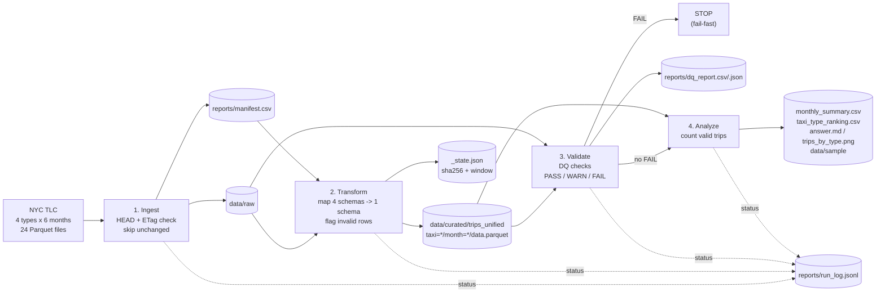

# Pipeline / Data Flow Diagram

## Curated schema (`trips_unified`)

| column | ความหมาย |
|---|---|
| taxi_type | Yellow Taxi / Green Taxi / FHV / HVFHV |
| source_file | ไฟล์ต้นทาง (ใช้ trace กลับ) |
| file_month | เดือนของไฟล์ (YYYY-MM) |
| pickup_datetime, dropoff_datetime | เวลาที่ map จาก column ของแต่ละ type |
| pu_location_id, do_location_id | zone รับ/ส่ง |
| invalid_reason | `null_pickup` / `out_of_range` / NULL |
| is_valid | TRUE ถ้า invalid_reason เป็น NULL |
| dropoff_before_pickup | ธง warning (ไม่ตัดทิ้ง) |
